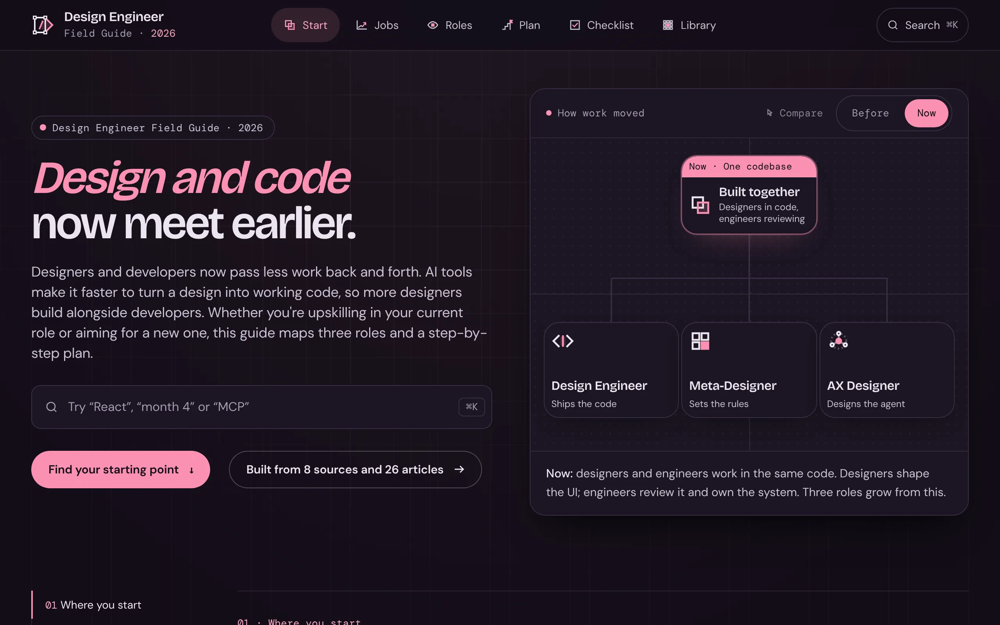
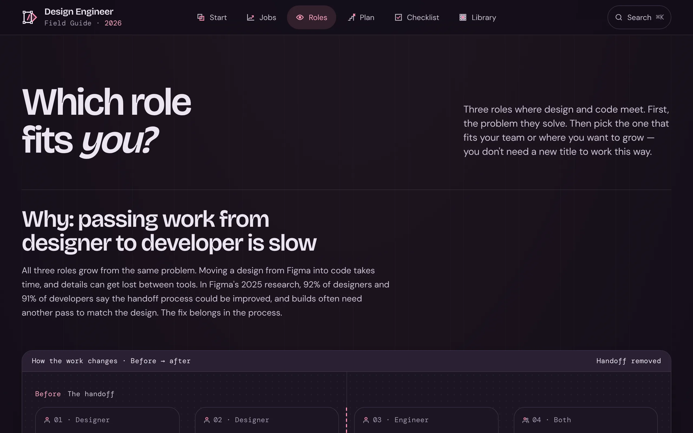
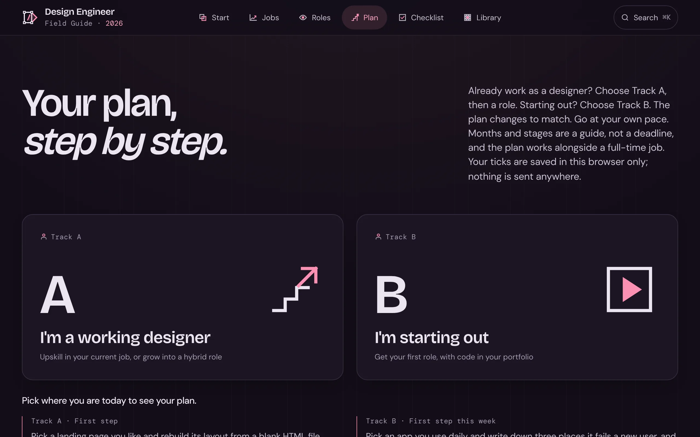
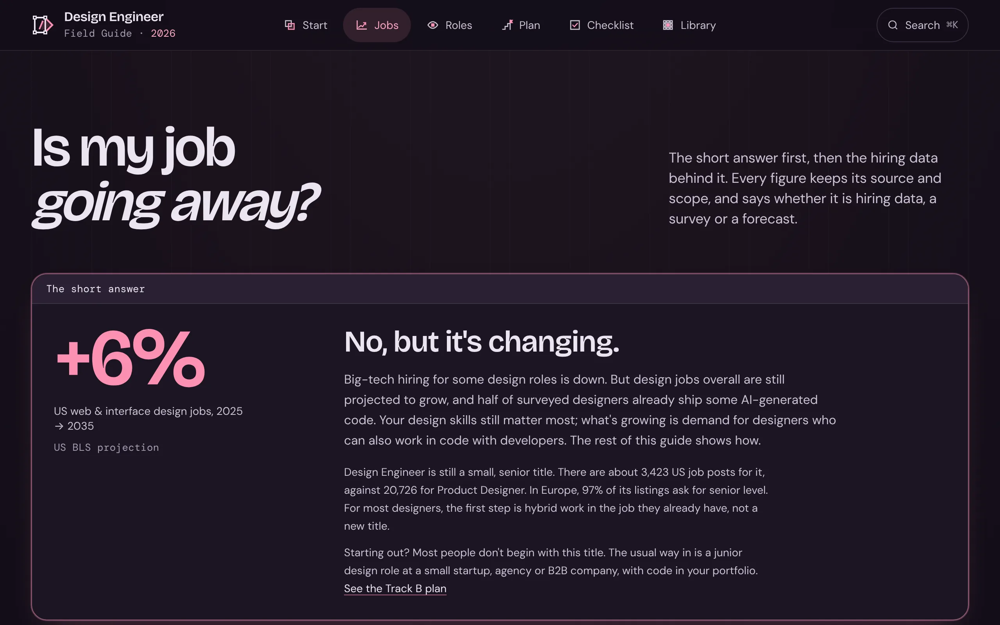
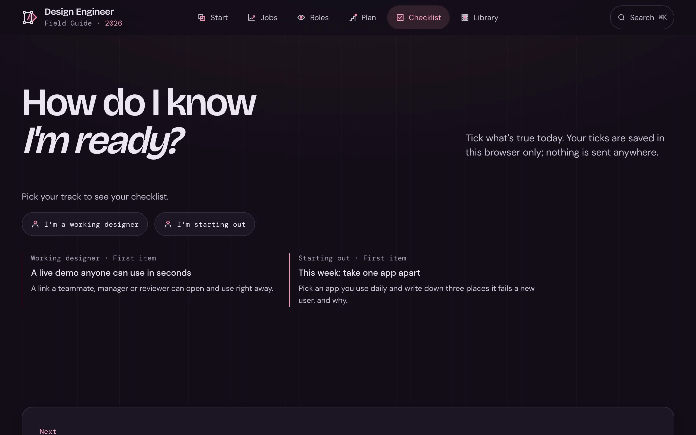
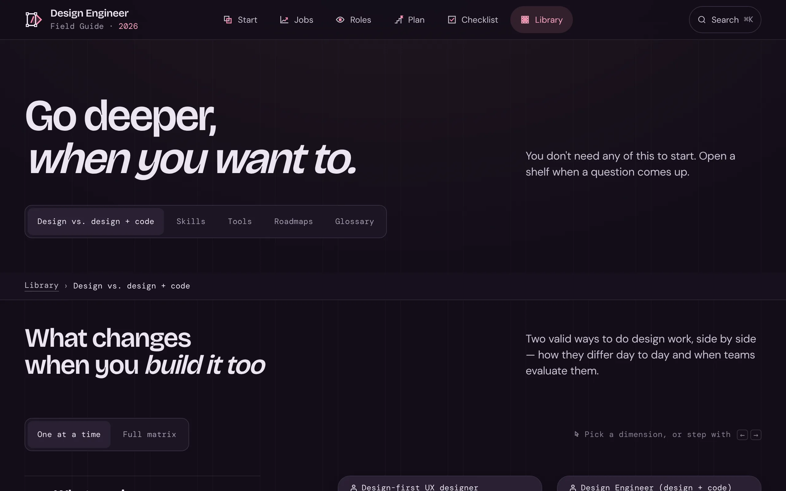
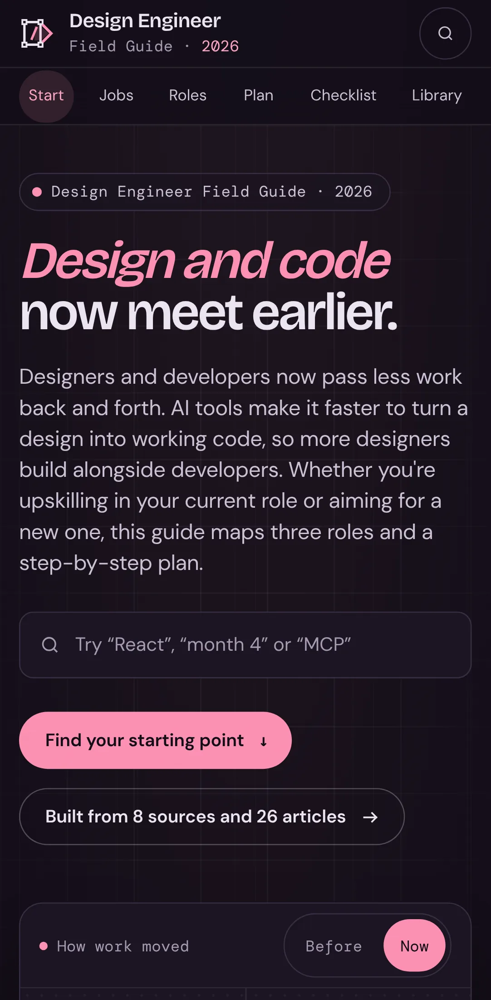
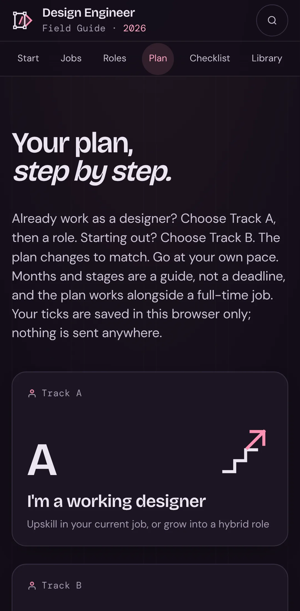

<div align="center">


# Design Engineer Field Guide

A free, open-source guide for designers learning to code and growing into **Design Engineer**, **Meta-Designer** and **Agentic Experience (AX) Designer** roles.

[**Open the guide →**](https://design-engineer-roadmap.vercel.app/)

[](https://github.com/saroj-shahi/design-engineer-roadmap/actions/workflows/ci.yml)
[](LICENSE)
[](#accessibility)
[](https://buymeacoffee.com/sarojshahi)



</div>

## Contents

- [About](#about)
- [Features](#features)
- [Screenshots](#screenshots)
- [Tech stack](#tech-stack)
- [Getting started](#getting-started)
- [Scripts](#scripts)
- [Project structure](#project-structure)
- [Accessibility](#accessibility)
- [Contributing](#contributing)
- [License](#license)
- [Credits](#credits)
- [Support](#support)

## About

Design and code now meet earlier. AI tools make it faster to turn a design into working code, so more designers build alongside developers. This guide maps the roles that grow from that change and gives you a step-by-step plan to get there.

It serves two readers:

- **Track A: working designers.** Upskill in your current role, or grow into a hybrid role.
- **Track B: people starting out.** Students, bootcamp grads and career switchers aiming for a first role.

Every figure traces back to a source, and each one shows what kind of evidence it is (survey, analytics, projection, case study or commentary).

## Features

| Page | What you get |
| --- | --- |
| **Start** (`#/`) | Market overview, a before/after view of how work moved, and a way to pick your track. |
| **Jobs** (`#/jobs`) | Is design work going away? The 2026 hiring data for designers, engineers and PMs, how teams are changing, and every market figure with its source. |
| **Roles** (`#/roles`) | Compare Design Engineer, Meta-Designer and AX Designer, with a skill overlap diagram and real handoff case studies. |
| **Plan** (`#/plan`) | A six-month plan for Track A and a four-stage plan for Track B, paired with [roadmap.sh](https://roadmap.sh) topic checklists. Download each plan as a PDF. |
| **Checklist** (`#/ready`) | Proof-of-work checklists for a team demo, a promotion case or a hybrid portfolio. |
| **Library** (`#/library`) | Role comparison, skills and agent protocol layers, an AI tooling pipeline, eight roadmap.sh syllabi and a plain-English glossary. |
| **Sources** (`#/sources`) | Where every figure comes from and how it was used. |

Also included:

- **Search everything** with <kbd>⌘</kbd> <kbd>K</kbd> (or <kbd>Ctrl</kbd> <kbd>K</kbd>).
- **Progress saved in your browser.** Ticks stay on your device; nothing is sent anywhere.
- **Shareable links.** Every view has its own URL, such as `#/plan/a/meta/m4`.
- **Works on any static host.** No backend, no accounts, no tracking.

## Screenshots

<table>
  <tr>
    <td width="50%"><br /><sub><b>Roles</b>: compare the three hybrid roles</sub></td>
    <td width="50%"><br /><sub><b>Plan</b>: a step-by-step plan for each track</sub></td>
  </tr>
  <tr>
    <td width="50%"><br /><sub><b>Jobs</b>: 2026 hiring data and how teams are changing</sub></td>
    <td width="50%"><br /><sub><b>Checklist</b>: know when you are ready</sub></td>
  </tr>
  <tr>
    <td colspan="2"><br /><sub><b>Library</b>: roadmaps, tooling and a plain-English glossary</sub></td>
  </tr>
</table>

<p align="center">
  
  &nbsp;&nbsp;
  
  <br />
  <sub>Built for phones too</sub>
</p>

## Tech stack

- [React 18](https://react.dev/) and [TypeScript](https://www.typescriptlang.org/)
- [Vite 5](https://vitejs.dev/) for the dev server and build
- [Tailwind CSS v4](https://tailwindcss.com/) with design tokens in `src/index.css`
- [Playwright](https://playwright.dev/) and [axe-core](https://github.com/dequelabs/axe-core) for end-to-end and accessibility tests
- ESLint 9 and Prettier
- Hosted on [Vercel](https://vercel.com/) with strict security headers (`vercel.json`)

No router library and no backend. Routing uses the URL hash, so the site works on any static host.

## Getting started

You need [Node.js](https://nodejs.org/) 20 or newer.

```bash
git clone https://github.com/saroj-shahi/design-engineer-roadmap.git
cd design-engineer-roadmap
npm install
npm run dev
```

Then open <http://localhost:5173/>.

To run the end-to-end tests for the first time, install the browser:

```bash
npx playwright install chromium
npm run test:e2e
```

## Scripts

| Command | What it does |
| --- | --- |
| `npm run dev` | Start the dev server at `localhost:5173` |
| `npm run build` | Typecheck and build to `dist/` |
| `npm run preview` | Serve the built `dist/` folder locally |
| `npm run check` | Lint, format check, typecheck and build (run before every pull request) |
| `npm run test:e2e` | Playwright tests at desktop and phone sizes, including an axe scan of every page |
| `npm run lint` | ESLint |
| `npm run format` | Prettier |
| `npm run pdfs` | Rebuild the plan PDFs in `public/plans/` after changing plan data |
| `npm run icons` | Rebuild the social image and app icons |

## Project structure

```text
├── public/              Static files: icons, social image, plan PDFs
├── scripts/             PDF, social image and UX probe scripts
├── src/
│   ├── App.tsx          App shell, hash routing, page titles
│   ├── pages/           One file per page
│   ├── sections/        Content blocks used by the pages
│   ├── components/      Shared UI, icons, diagrams and widgets
│   ├── data/
│   │   ├── research.ts  Single source of truth for all figures and content
│   │   └── roadmaps.ts  roadmap.sh curricula
│   └── index.css        Design tokens and Tailwind theme
├── tests/e2e/           Playwright and axe tests
└── docs/                Reviews and README screenshots
```

For a deeper guide to the code, read [AGENTS.md](AGENTS.md). For the "Plum Dusk" design system (color tokens, type, icons and the visual QA checklist), read [DESIGN.md](DESIGN.md).

## Accessibility

Accessibility is a requirement, not an extra:

- Every page is scanned against WCAG 2.2 A and AA in CI.
- Everything works with a keyboard, and focus is always visible.
- Every control has at least a 44px tap area on phones.
- Motion respects `prefers-reduced-motion`.
- The site works with browser storage blocked.

Found a barrier? Please [open an issue](https://github.com/saroj-shahi/design-engineer-roadmap/issues/new/choose).

## Contributing

Fixes to content, accessibility and bugs are welcome. Read [CONTRIBUTING.md](CONTRIBUTING.md) before you start. For a big change, open an issue first so we can agree on the direction.

To report a security issue, see [SECURITY.md](SECURITY.md).

## License

The code is released under the [MIT License](LICENSE).

## Credits

- Figures and sources come from "The 2026 Product Design Evolution" research brief. See the [Sources page](https://design-engineer-roadmap.vercel.app/#/sources).
- Topic outlines follow [roadmap.sh](https://roadmap.sh). Check its terms before reusing that content.
- Fonts: [Bricolage Grotesque](https://fonts.google.com/specimen/Bricolage+Grotesque), [DM Sans](https://fonts.google.com/specimen/DM+Sans) and [DM Mono](https://fonts.google.com/specimen/DM+Mono), all under the SIL Open Font License.
- Product names and logos in the tooling pipeline belong to their owners and are shown only to identify those products.

## Support

If this guide helped you, you can [buy me a coffee](https://buymeacoffee.com/sarojshahi) or star the repo.

Made by [Saroj Shahi](https://sarojshahi.com).
